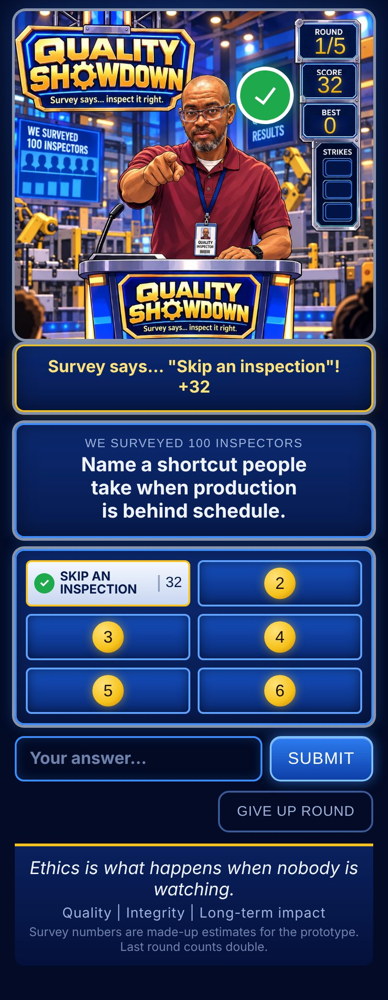

# Quality Showdown

*Survey says… inspect it right.*

A survey-style game show about quality inspection in manufacturing, hosted by Marcus Faulkner. Players guess the most common answers to shop-floor questions (line audits, NCRs, first article inspection, gauge calibration) before they collect three strikes.

It is plain HTML, CSS and JavaScript. There is no build step and nothing to install, so it runs from any static host, including GitHub Pages and itch.io.
## Play

🎮 **Play Quality Showdown:**  
[https://marusfaulkner.github.io/quality-showdown/](https://marusfaulkner.github.io/quality-showdown/)

Works in your browser. No install, no account, no build step.



## How to play

- Each game is 5 rounds drawn at random from the question bank.
- Type an answer and press **Submit**. Matching answers flip on the board and add their points.
- Three wrong answers end the round. You can also give up the round to reveal the board.
- The last round counts double.
- Your final score gets a **PASS** stamp at 50% or more of the available points, or **REWORK** below that. Your best score is saved in your browser.

## Run it locally

Open `index.html` in a browser. To serve it the way a host would:

```bash
python3 -m http.server 8000
# then open http://localhost:8000
```

## Project structure

```
index.html          Page markup; loads the CSS and the three scripts in order
css/style.css       Studio theme (navy / gold / neon blue), layout, animations
js/questions.js     Question bank and game constants (rounds, strikes)
js/audio.js         Original synthesized sound package (Web Audio API)
js/matching.js      Answer matching: normalization + typo tolerance
js/game.js          Game state, rendering, and event wiring
assets/stage.webp   Studio art with the host; scoreboard values are overlaid live
tests/              Node tests for matching and question-bank data
docs/               README screenshot
```

## Adding or editing questions

Questions live in `js/questions.js`. Each answer is an array of display text, points, then optional aliases:

```js
{ q: "Name a disposition for a nonconforming part.", a: [
  ["Scrap", 36],
  ["Rework", 28],
  ["Use as is", 14, "use as-is", "deviation", "concession"],
  // ...
] }
```

Rules the tests enforce:

- Points per question total 100 or less (100 people surveyed).
- 4 to 8 answers per question, sorted from most to fewest points.
- Every answer can be matched by its own display text.

Add aliases for the ways people on your floor actually say things ("cop" for "Police officer", "out of cal" for "Expired calibration").

**The current point values are placeholder estimates.** To make the survey real, poll your team and replace the numbers.

## Sound

Every sound is original and synthesized live in the browser with the Web Audio API (`js/audio.js`). There are no audio files, so there is nothing to license or download.

| Moment | Cue |
|---|---|
| Show open (**Start the show**) | Brass fanfare intro |
| During questions | Low "thinking" loop: walking bass, offbeat keys, hi-hat |
| Answer revealed | Bell DING |
| Strike | Low BUZZ |
| Into the final round | Rising tension cue, then the loop returns faster |
| Board cleared / PASS | Win sting |
| REWORK result | Descending "wah-wah" |

Browsers block audio until the player taps something, so the game opens behind a **Start the show** button. **Sound on/off** mutes everything, and the setting is remembered. To tune a cue, edit its function in `js/audio.js`. Notes are written as MIDI numbers (60 = middle C).

## How answer matching works

`js/matching.js` scores each guess against every answer and alias:

1. **Normalize.** Lowercase, strip punctuation, drop filler words (*the, my, a…*), and singularize simple plurals.
2. **Exact match** scores highest.
3. **Typo tolerance.** Uses Levenshtein distance: 0 edits for words of 4 letters or fewer, 1 for 5–7 letters, 2 for longer words.
4. **Contained words.** "I'd tell my supervisor" matches "supervisor".

The best-scoring answer wins. A repeat of an answer already on the board doesn't cost a strike.

## Tests

Requires Node 18 or newer. There are no dependencies.

```bash
node --test
```

GitHub Actions runs the same command on every push and pull request (`.github/workflows/test.yml`).

## Deploy

**GitHub Pages:** go to *Settings → Pages*, set *Source: Deploy from a branch*, and choose `main` and `/ (root)`.

**itch.io:** zip the contents of this folder so that `index.html` sits at the top level of the zip, not inside a subfolder. Upload it as an HTML project and check *This file will be played in the browser*.

## Credits

- Game design and host: Marcus Faulkner
- Stage art: generated with ChatGPT from Marcus's likeness
- Fonts: [Russo One](https://fonts.google.com/specimen/Russo+One) and [Barlow Semi Condensed](https://fonts.google.com/specimen/Barlow+Semi+Condensed) via Google Fonts (SIL Open Font License)

## License

Code is released under the [MIT License](LICENSE). The host artwork in `assets/` depicts Marcus Faulkner and is **not** covered by the MIT license. Do not reuse it without permission.
